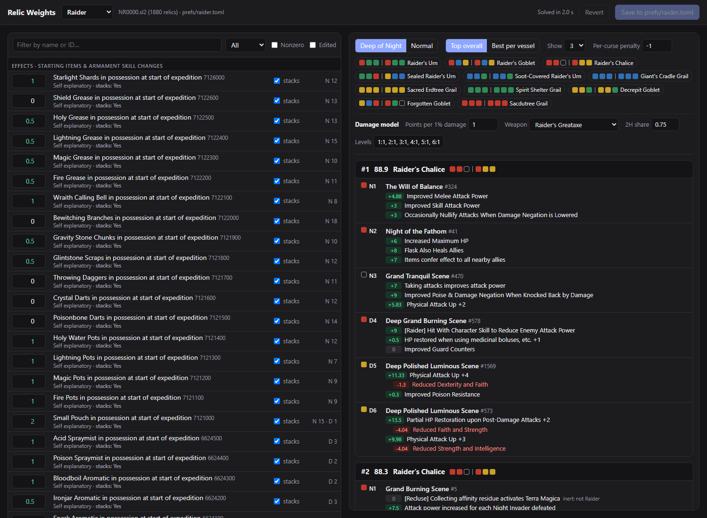

# Nightreign relic optimizer

This is a vibe-coded project I whipped up in 1 hour with Claude Opus 5.5.

Author: Tijmen de Haan
Date: 2026-10-27

Feedback welcome.

----

Finds the best *Elden Ring Nightreign* relic loadout. It reads your relic inventory straight from your save file, scores every relic, and finds your optimal build.



## Launching the UI

You need [uv](https://docs.astral.sh/uv/) and Windows (the save is read from `%APPDATA%\Nightreign`).

```
git clone https://github.com/tijmen/nightreign-relic-optimizer
cd nightreign-relic-optimizer
uv run relic_ui.py
```

This opens http://127.0.0.1:8765/ in your browser. Pick a nightfarer at the top and *Deep of Night* or *Normal* above the results. The optimal build depends on your playstyle and what you care about, so edit the weights to express how much you care about each effect. The loadouts update automatically. **Save** writes your weights to `prefs/<character>.toml` so you can come back next time. Your Nightreign save file is only ever read, never written. Reload the page to reload the save file. 

If you have more than one save file, or if you have your relics in xlsx you can use `uv run relic_ui.py path/to/NR0000.sl2`, or an `.xlsx` export from the [Nightreign Relic Editor](https://github.com/alfizari/Elden-Ring-Nightreign-Save-Editor). If you don't want to run in the browser, you can use the command-line version with `uv run relic_opt.py`. More details: [docs/details.md](docs/details.md).

## Credits

Save format, game text and relic tables: [alfizari/Elden-Ring-Nightreign-Save-Editor](https://github.com/alfizari/Elden-Ring-Nightreign-Save-Editor) (MIT, see `reference/save_editor/LICENSE`). Effect stacking rules: the community "Nightreign Useful Info" sheet. Stat scaling: the "Nightreign Attack Power Calculator" by Cryptid Tracker.
