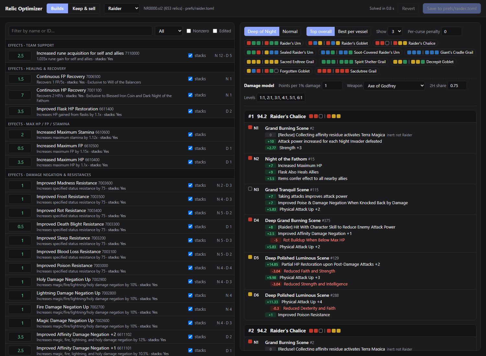
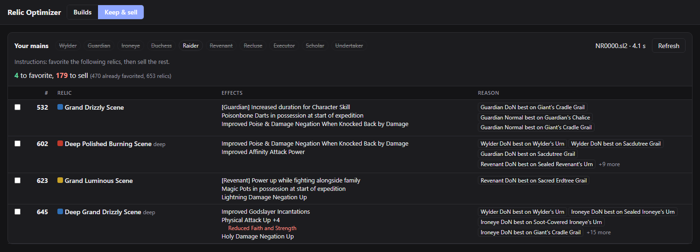

# Nightreign Relic Optimizer

A vibe-coded app that reads your *Elden Ring Nightreign* save, finds your best relic builds, and tells you which relics to keep before you sell the rest.

Nightreign Relic Optimizer only ever reads your save file and never writes to any game files. It's an advisor, not a cheat.

Author: Tijmen de Haan<br>
Date: 2026-10-27

## Quick start

Needs [uv](https://docs.astral.sh/uv/) and Windows.

```
git clone https://github.com/tijmen/nightreign-relic-optimizer
cd nightreign-relic-optimizer
uv run relic_ui.py
```

This opens http://127.0.0.1:8765/. Reload the page to re-read the save.

## Builds

Pick a nightfarer and set how much each effect is worth to you; the best loadouts update as you edit. **Save** keeps your weights in `prefs/<character>.toml`.



## Keep & sell

Pick your main(s), favorite the listed relics in game, then sell everything that isn't favorited.



Command-line versions, other save files, `.xlsx` exports and the scoring rules: [docs/details.md](docs/details.md).

## Credits

Save format, game text and relic tables: [alfizari/Elden-Ring-Nightreign-Save-Editor](https://github.com/alfizari/Elden-Ring-Nightreign-Save-Editor) (MIT, see `reference/save_editor/LICENSE`). Effect stacking rules: the community "Nightreign Useful Info" sheet. Stat scaling: the "Nightreign Attack Power Calculator" by Cryptid Tracker.
